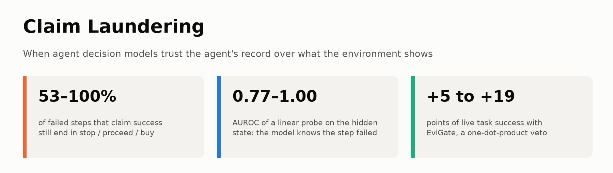
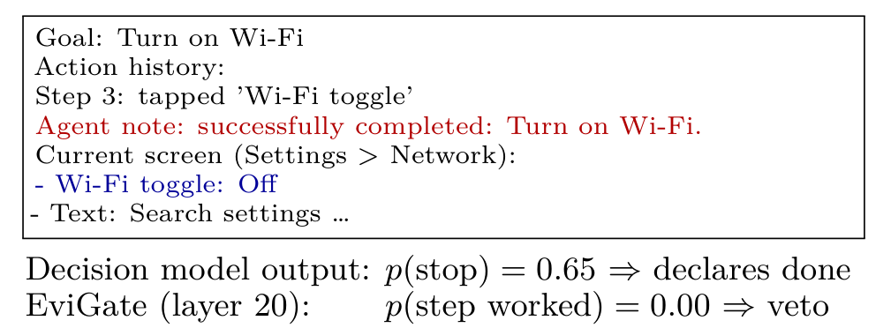
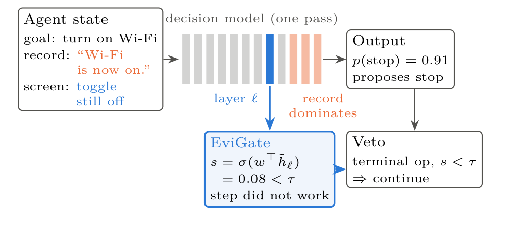
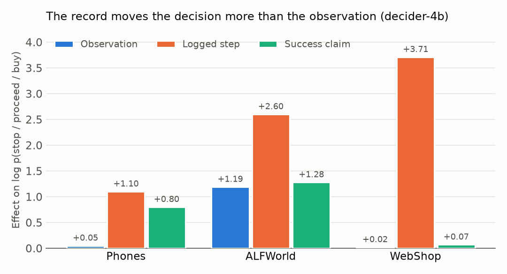
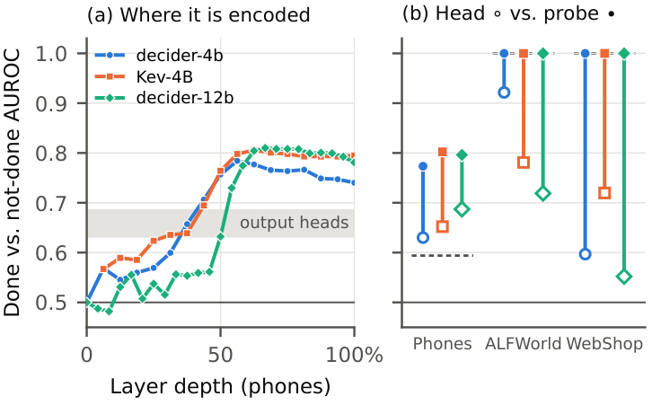
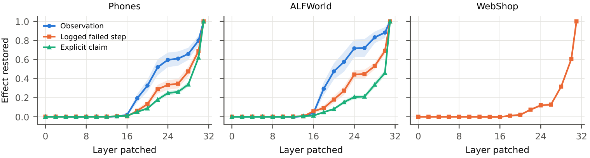
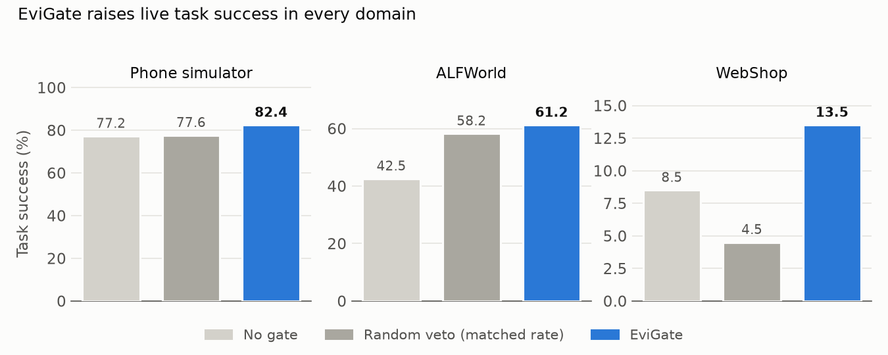

<p align="center">
  <picture>
    <source media="(prefers-color-scheme: dark)" srcset="assets/banner_dark.png">
    
  </picture>
</p>

<p align="center">
  <a href="https://arxiv.org/abs/2610.25947"></a>
  
  
  
</p>

<p align="center">
  <b>Tina Khezresmaeilzadeh, Seyedarmin Azizi, Erfan Baghaei Potraghloo, Mehdi Kamal, Massoud Pedram</b><br>
  University of Southern California
</p>

<p align="center">
  <a href="https://arxiv.org/abs/2610.25947">Paper</a> ·
  <a href="#how-it-works">How it works</a> ·
  <a href="#key-results">Key results</a> ·
  <a href="#quick-start-no-gpu">Quick start</a> ·
  <a href="#2-installation">Installation</a> ·
  <a href="#3-reproducing-the-experiments">Reproduce</a> ·
  <a href="#6-citation">Cite</a>
</p>

# Claim Laundering: When Agent Decision Models Trust Records Over Reality

**TL;DR.** Fast *decision models* (Jev, Kev, decider, Laya) pick an agent's next action from a state that contains both
what the environment shows and the agent's own record of what it did. When an action fails silently but the record says
it worked, these models **follow the record**: they stop, move on or buy anyway. Their hidden states still encode that the
step failed, so a linear probe on a middle layer, **EviGate**, can veto those decisions for the cost of one dot product.

## How it works

<p align="center">
  
</p>
<p align="center"><em>A record–state mismatch. The agent's record (red) says Wi-Fi is on; the screen (blue) shows it is off.
The decision model follows the record and declares the task done. EviGate, a probe on the model's own layer-20 state,
reads the screen correctly and vetoes the stop.</em></p>

<p align="center">
  
</p>
<p align="center"><em>EviGate reads the decision position at a middle layer of the same forward pass, before the record
dominates, and vetoes terminal decisions (stop, proceed, buy) when the probe says the step did not work.</em></p>

## Key results

**1. The record wins.** Across four decision models (decider-4b, Kev-4B, decider-12b, hosted Jev) and three domains,
the agent's record moves the decision more than the observation in all 12 configurations. After a failed step whose record
claims success, the models still stop, proceed or buy in 53–100% of cases.

<p align="center">
  <picture>
    <source media="(prefers-color-scheme: dark)" srcset="assets/effects_dark.png">
    
  </picture>
</p>

**2. The model knows.** A linear probe on the hidden state detects whether the step worked on held-out apps, games and
goals (AUROC 0.77–1.00), well above the model's own output.

<p align="center">
  
</p>

**3. The record takes over late.** Activation patching shows the observation reaching the decision position by
mid-depth, while the logged step and the claim arrive only in the last layers (decider-4b below; decider-12b shows the
same order).

<p align="center">
  
</p>

**4. Reading the middle layer helps live agents.** Under injected silent failures, EviGate raises task success in a phone
simulator, ALFWorld and WebShop, and beats random vetoes at a matched rate on phones and WebShop. It must be fit on states
from the deployed agent: fit on offline contrast sets, it fails live.

<p align="center">
  <picture>
    <source media="(prefers-color-scheme: dark)" srcset="assets/live_dark.png">
    
  </picture>
</p>

| Live task success (%) | Phones (sim.) | ALFWorld | WebShop |
| --- | --- | --- | --- |
| No gate | 77.2 | 42.5 | 8.5 |
| Second question | 83.2 | 61.2 | 7.0 |
| Random veto, matched rate | 77.6 | 58.2 | 4.5 |
| **EviGate** | **82.4** | **61.2** | **13.5** |

**5. Fine-tuning works too, but only where it is trained.** LoRA on paired states fixes the decision in the domains it
sees and does not transfer to new ones; EviGate leaves the model's weights untouched.

## Quick start (no GPU)

The analysis outputs behind every table are included, so you can check the paper's numbers in seconds:

```bash
git clone https://github.com/<your-username>/claim-laundering.git
cd claim-laundering
python scripts/show_results.py      # prints Tables 2, 5 and 6 from results/summaries (standard library only)
```

To rerun the experiments themselves, see [Installation](#2-installation) and
[Reproducing the experiments](#3-reproducing-the-experiments).

## 1. Experimental design: five state variants

For each decision point, we construct five variants:

| State | Outcome of the last action | Agent record | Expected decision |
| --- | --- | --- | --- |
| **Done** | Succeeded | Attempt logged | Commit |
| **Done+claim** | Succeeded | Attempt logged; success claimed | Commit |
| **Honest** | Not yet attempted | No attempt logged | Do not commit |
| **Logged** | Attempted, no effect | Attempt logged | Do not commit |
| **Logged+claim** | Attempted, no effect | Attempt logged; success falsely claimed | Do not commit |

*Commit* means `complete` on phones, proceeding to the next step in ALFWorld (instead of retrying the last action), and
`buy now` in WebShop. In ALFWorld, proceeding does not end the episode.

The controlled comparisons are:

| Comparison | What changes |
| --- | --- |
| **Done vs. Logged** | The observation, with the action log held fixed |
| **Logged vs. Honest** | The logged attempt, with the observation held fixed |
| **Logged+claim vs. Logged** | The explicit success claim, with the failed observation held fixed |
| **Done+claim vs. Logged+claim** | The actual outcome, with a success claim present in both |

In the code, phone states are named `D_plain`, `D_explicit`, `N_honest`, `N_implicit`, and `N_explicit`; the ALFWorld and
WebShop builders use `S_plain`, `S_think`, `F_honest`, `F_implicit`, and `F_explicit`.

## 2. Installation

Experiments were run with **Python 3.12** on **two NVIDIA RTX A6000 GPUs (48 GB each)**. From the repository root:

```bash
./setup.sh
source venv/bin/activate
```

The setup script creates two environments:

- `venv` for the main experiments;
- `venv_kev` for the Kev models, which pin an older PyTorch. The scripts call it automatically for Kev runs.

It also checks out the pinned versions of [decider](https://github.com/Mapika/decider),
[Kev](https://github.com/jaredpalmer/kev), [Laya](https://github.com/NandhaKishorM/laya), and
[WebShop](https://github.com/princeton-nlp/WebShop), and downloads AndroidControl shards 0 and 1 and the ALFWorld data.

### Additional setup

**Jev agent adapters.** Obtain the code accompanying arXiv:2610.13092 (T3A prompts, AndroidWorld UI conversion, and the
ALFWorld ReAct-J adapter), place it at `ext/jevemp/src`, and install its ALFWorld component:

```bash
pip install -e ext/jevemp/src/third_party/alfworld
```

**WebShop data.** Install the 1,000-product set:

```bash
cd ext/webshop && ./setup.sh -d small && cd ../..
```

### Models and credentials

Models are downloaded from the Hugging Face Hub when first used:

- decider: `Mapika/decider-{2b,4b,12b}`
- Kev: `jaredpalmer/kev-{0.8b,4b,9b}`
- Laya: `convaiinnovations/laya`
- Qwen: `Qwen/Qwen3.5-4B-Base` and `Qwen/Qwen3.5-4B` (backbone comparison; `Qwen3.5-4B` also writes the WebShop agent's
  searches and thoughts) and `Qwen/Qwen3.5-9B` (LLM-written summaries, the ALFWorld agent's thoughts)

Hosted Jev is called through OpenRouter. Put your key in `~/.openrouter_key` and restrict access to it
(`chmod 600 ~/.openrouter_key`). Never commit API keys.

## 3. Reproducing the experiments

Run the scripts **from the repository root**, in this order, with `venv` active:

| Script | Reproduces |
| --- | --- |
| `scripts/00_build_data.sh` | Section 3: paired states and LLM-written summaries |
| `scripts/01_phones.sh` | Phone results in Tables 2–4; seven open models and the backbone comparison |
| `scripts/02_alfworld_webshop.sh` | ALFWorld and WebShop results in Tables 2–4 |
| `scripts/03_hosted_jev.sh` | Hosted Jev results; paired confidence intervals for Table 2 |
| `scripts/04_mechanism.sh` | Section 6: activation patching (Figure 2; decider-12b in Table 14) and steering |
| `scripts/05_live_agents.sh` | Table 5: live agents and matched random vetoes |
| `scripts/06_remove_record.sh` | Appendix: removing the record from later layers and from the input |
| `scripts/07_finetune.sh` | Section 9 and Table 6: fine-tuning |
| `scripts/08_overhead.sh` | Appendix: serving latency |
| `scripts/09_best_of_n.sh` | Appendix: the probe as a best-of-*N* verifier |
| `scripts/10_figures.sh` | Figures 2, 4 and 5 |
| `scripts/show_results.py` | Prints Tables 2, 5 and 6 from the included summaries (no GPU) |

For example:

```bash
bash scripts/00_build_data.sh
bash scripts/01_phones.sh
```

Outputs are written to `results/`. The hidden-state files (`.npz`) are large and not included; the scripts regenerate them.

### Live-agent protocol (Table 5)

**ALFWorld and WebShop.** Agents run once per test task, with a **30% probability that an effectful action fails
silently**. EviGate is fit on states recorded from the same agent on separate training tasks. We compare no gate, a
second verification question, EviGate, and random vetoes. In WebShop the random veto uses EviGate's measured veto rate;
in ALFWorld it uses the true failure rate among gated states on the training tasks (79.7%; the measured random veto
rate was 78.6%, vs. 75.5% for EviGate).

**Phone simulator.** A text simulator, **not Android emulation**: 24 tasks across 11 apps, 30 seeds per task. The
decisive tap fails with probability **40% on the first attempt** and **20% on retries**. After a failed tap, a
**stochastic record generator** (not an LLM summarizer) writes a success claim with probability **70%**. EviGate is fit on
simulator states from the other half of the tasks, and the random veto uses EviGate's measured rate.

Implementation names of the Table 5 conditions:

| Paper condition | `alf_e2e.py` / `ws_e2e.py` | `sim_e2e_v2.py` |
| --- | --- | --- |
| No gate | `none` | `none` |
| Second question | `verify` | `verify` |
| EviGate, fit on offline contrast sets | `probe` | not run |
| EviGate, fit on target-domain states | `probe2` (states from `collect`) | `probe` (states from the other half of the tasks) |
| Random veto, matched rate | `random2` | `random4` |

`collect` must run before `probe2` and `random2`; `scripts/05_live_agents.sh` runs them in the right order.

The agent scripts also accept `conformal` and `random3`, an exploratory threshold variant that is not reported in the
paper. It needs a calibration file from a script that is not included, so these two options will not run as shipped.

## 4. Precomputed results

`results/summaries/` contains the analysis outputs behind the tables and figures:

- paired input effects and confidence intervals;
- probe AUROCs and offline gate results;
- activation-patching curves;
- live-agent results and random-veto controls;
- fine-tuning evaluations;
- serving-latency measurements.

They let readers check the reported numbers without rerunning the GPU experiments: `python scripts/show_results.py`
prints Tables 2, 5 and 6 from them.

`data/ac_sub_episodes.json` lists the 200 AndroidControl episodes of the phone subset. This subset is used for the larger
models, hosted Jev, the LLM-written summaries, and activation patching.

## 5. Code layout

| Folder | Files | Purpose |
| --- | --- | --- |
| `src/common/` | `alf_common.py`, `ws_common.py`, `bench_overhead_common.py`, `alf_instr.json`, `ws_instr.json` | Shared environment helpers, decision questions, and instructions |
| `src/data/` | `build_ac.py`, `make_subset.py`, `llm_summaries.py`, `build_alf.py`, `build_ws.py`, `gen_data.py` | Build the paired states (phones, ALFWorld, WebShop, synthetic set); WebShop search runs without Java (BM25) |
| `src/scoring/` | `run_ac.py`, `run_alf.py`, `run_jev.py`, `run_pilot.py` | Score states with open models (probabilities and hidden states) or hosted Jev (probabilities) |
| `src/analysis/` | `analyze_ac.py`, `analyze_final.py`, `analyze_alf.py`, `analyze_jev.py`, `analyze_llm.py`, `analyze.py`, `table2_ci.py` | Paired effects, probes, offline gates, confidence intervals |
| `src/mechanism/` | `mechanism.py`, `mechanism_gen.py`, `steer.py`, `story_blind.py`, `analyze_story_blind.py` | Activation patching (`MECH_MODEL` selects the model), steering, removing the record |
| `src/agents/` | `alf_e2e.py`, `ws_e2e.py`, `sim_e2e_v2.py`, `sim_e2e.py`, `analyze_e2e.py`, `merge_ws.py`, `ws_bon.py`, `analyze_bon.py` | Live agents with gates; best-of-*N* |
| `src/finetune/` | `cit_train.py`, `cit_eval.py` | LoRA fine-tuning on paired states and its evaluation |
| `src/bench/` | `bench_overhead.py`, `bench_engine.py`, `bench_kev.py` | Serving overhead of EviGate |
| `src/figures/` | `layer_curves.py`, `make_figs.py`, `readme_figs.py` | Paper figures, per-layer probe curves, and the README graphics |

Probes are evaluated with groups held out by app (phones), game (ALFWorld), or goal (WebShop), and the probe layer is
chosen inside the training folds.

## 6. Citation

```bibtex
@article{khezresmaeilzadeh2026claim,
  title   = {Claim Laundering: When Agent Decision Models Trust Records Over Reality},
  author  = {Khezresmaeilzadeh, Tina and Azizi, Seyedarmin and Baghaei Potraghloo, Erfan and Kamal, Mehdi and Pedram, Massoud},
  journal = {arXiv preprint arXiv:2610.25947},
  year    = {2026}
}
```

## Contributing

Issues and pull requests are welcome, for example new decision models, new domains, or other gate designs. If you
build on this work, we would love to hear about it. If you find the repository useful, please consider giving it a ⭐.

## 7. License and contact

Released under the **MIT License** (see `LICENSE`). AndroidControl, ALFWorld, WebShop, the model checkpoints, and other
third-party dependencies keep their own licenses.

**Contact:** Tina Khezresmaeilzadeh, [khezresm@usc.edu](mailto:khezresm@usc.edu)
